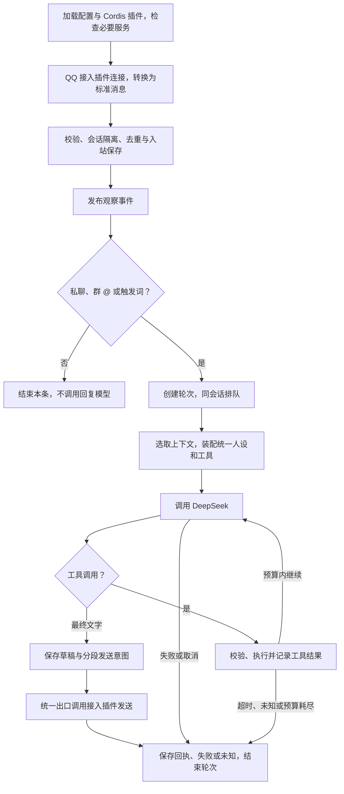

# 小狼主链路

更新日期：2026-10-15。合并原“主链路功能与执行流程”和“主链路插件化方案”的有效内容。本文说明执行方式和扩展边界；产品要求见 [需求记录](需求记录.md)，完成情况与部署状态见 [实现进度](实现进度.md)。

当前基线是 TypeScript＋Cordis 4 自写文字链路、QQ 官方接入、DeepSeek 模型。下文明确标注后续设计，避免把预留位置误认为已实现能力。

## 一次回复如何发生

主链路只处理标准消息和服务接口。QQ 鉴权、平台事件、OpenID、被动回复字段和网络回执留在接入插件；连接状态不等于每一种群消息权限都已验证。

## 按执行顺序的功能

| 步骤 | 当前职责 | 关键边界 |
| --- | --- | --- |
| 01 配置 | 读取接入、模型、人设、限额和插件组合，检查格式。 | 密钥由环境提供，不进仓库、镜像或普通日志。 |
| 02 装配 | Cordis 挂载存储、调度、触发、模型、工具、输出、观察等服务，选择唯一聊天编排。 | 启用插件缺文件、依赖或必要服务时启动失败，不带病连接 QQ。 |
| 03 接入 | 唯一 Adapter 管理鉴权、WebSocket、连接状态与重连。 | 当前只实现 QQ 官方 C2C 与群聊；没有 OneBot 或 Webhook 服务。 |
| 04 转换 | 平台消息转换为标准账号、发送者、群／私聊、消息 ID、时间及有序消息段。 | 已支持文字与 @；媒体保留不支持标记，引用原文与图片理解后续补。 |
| 05 校验与去重 | 排除机器人回流、无效来源及重复事件。 | 不按正文去重；相同句子可以是两条不同消息。平台／环境、账号、会话和消息 ID 共同隔离。 |
| 06 入站保存 | 定位会话，保存接纳的消息，分配输入顺序。 | 私聊按对方隔离，群聊按群隔离并保留说话人；普通未触发消息也保存。 |
| 07 观察 | 发布 `xiaolang/observed`，供后续收集、学习等能力订阅。 | 观察者失败不阻断聊天；观察不自动获得发言权。 |
| 08 触发 | 私聊默认；群 @ 自身或直接文本任意位置包含配置词，记录触发理由。 | 多条件只创建一次默认任务；未触发不调用回复模型；主动插话未实现。 |
| 09 调度 | 创建轮次，同会话 FIFO，跨会话有限并发；限制队列容量与等待时间。 | 不自动合并、插队或打断前一轮；后到普通消息不悄悄变成本轮请求。 |
| 10 上下文 | 执行时读取本会话历史，固定到本条触发消息的输入边界。 | 当前触发消息只进入一次；较早任务的已发送回复可供后续任务使用。 |
| 11 人设与预算 | 装配统一临时人设、上下文和工具定义，限制输入长度。 | 字符预算不是精确 token 数；工具请求与结果成组裁剪；Memory 和摘要未实现。 |
| 12 模型 | 调用 DeepSeek，适配必要续接字段，处理取消、限流、超时和有限重试。 | 完整取得回复后发送 QQ；不会逐 token 发 QQ，也没有单独规划模型。 |
| 13 工具 | 模型自主选择已注册工具；检查名称和参数，记录开始与结果。 | 不能任意指定命令执行；当前只有查询时间示例工具。 |
| 14 循环 | 工具结果连同对应请求交还模型，在轮数、时间和长度预算内继续。 | 伴随工具请求的说明文字不先发 QQ；未知副作用不让模型重试。 |
| 15 输出 | 保存最终草稿，按 Unicode 与平台限额拆分，先记录发送意图。 | 草稿不等于已交付内容；当前只发送纯文字。 |
| 16 发送 | 统一输出服务检查目标、取消和段序，通过 Adapter 被动回复。 | 当前 QQ 插件采用 5 分钟、最多 5 段的保守限制；过期不降级为主动推送。 |
| 17 结算 | 保存逐段平台回执、失败、未知和部分成功；已确认内容进入可见历史。 | 平台接受发送不等于对方已读；未知结果不自动重发。 |
| 18 收尾 | 结束轮次、释放执行权，记录关联过程日志；退出时清理插件资源。 | 重启保留历史，未完成工作标为中断或未知，不自动重放工具和发送。 |

触发示例：群里“今天小狼怎么没说话”会触发；没有 @ 或触发词时不会默认回复。@ 全体、引用文字、OCR 当前不作为触发依据，属于可调整的工程策略。

## 异常和持久化

轮次状态以代码为准：`queued`、`running`、`sending`，最终为 `completed`、`failed`、`cancelled`、`unknown` 或 `expired`。

| 情况 | 当前处理 |
| --- | --- |
| 模型失败／限流 | 在预算内有限重试；确定性错误不反复请求，不连带重放已完成工具。 |
| 工具参数错误或只读查询普通失败 | 返回明确失败结果，允许模型在剩余预算内调整。 |
| 副作用工具发出后失败、取消或超时 | 保守记录未知并停止本轮，不能假定外部操作没有发生。 |
| 发送明确拒绝 | 记录失败；不把草稿当作已发送回复。 |
| 发送回执丢失或传输结果不明 | 保留意图和未知状态，不自动重发同一段。 |
| 多段只成功一部分 | 仅保存已确认内容，其他段分别标记；不整条重发。 |
| 队列满、等待过期或轮次取消 | 记录结束状态，释放资源；QQ 内统一故障提示尚未实现。 |
| 进程重启／接入重连 | 读取已有历史；中断任务不自动重放；不承诺补齐断线期间消息。 |
| 日志或观察插件失败 | 独立报告，不改变聊天处理结果。存储等必要服务失败则不能冒充成功。 |

SQLite 保存入站事实、轮次、草稿、工具与分段发送状态。发送确认与已交付上下文在本地事务中更新，但不能保证 QQ 与本地数据库跨系统的绝对一次执行。

日志按消息／轮次关联各阶段和耗时，经独立插件脱敏并限制正文预览；不输出完整提示词、思考、工具参数或工具结果。聊天／日志后台读取明确的只读投影，不暴露内部草稿或完整模型协议；模型和 QQ 编辑走单独的配置服务。

## 插件化如何落地

Cordis 提供上下文、服务依赖、事件与生命周期；小狼定义业务接口和默认提供者。主链路的步骤不要求各自发布一个 npm 包，插件也不等于独立容器。

| 边界 | 代码位置 | 协作方式 |
| --- | --- | --- |
| 启动与装配 | `src/main.ts`、`src/app.ts`、`src/plugins.ts` | 挂载服务、选择接入和聊天插件、检查就绪、组织退出。 |
| 接入 | `src/adapters/qq-official.ts` | 提供 `adapter`：身份、能力声明、`start(receive)`、`stop()`、`reply()`；其他平台细节不进入主链路。 |
| 入站与触发 | `src/messages.ts`、`src/app.ts` | 提供 `intake`、`trigger`，发布消息与观察事件。 |
| 存储与调度 | `src/store.ts`、`src/scheduler.ts` | 提供 `store`、`historyReader`、`scheduler`；存储不决定长期记忆策略。 |
| 模型与工具 | `src/model.ts`、`src/tools.ts` | 提供 `model`、`tools`；注册工具返回清理函数，归插件生命周期管理。 |
| 默认聊天编排 | `src/chat.ts` | 提供 `chat`，串联触发、排队、上下文、模型／工具、输出与结算。 |
| 统一输出 | `src/output.ts` | 提供 `output`，经唯一 Adapter 发送并记录结果。 |
| 日志与后台 | `src/logging.ts`、`src/inspection.ts`、`src/configuration.ts`、`examples/plugins/` | 脱敏事件、只读查询、限定模型／QQ 区域的配置读写；中文终端和网页是外挂插件。 |

服务调用用于需要返回值的工作，事件用于通知事实。插件通过声明的接口协作，不直接改其他插件内部对象；监听器、连接、定时器和任务要有清理归属。停用插件不删除用户数据。

外部目录／npm 插件直接复用 Cordis 官方 Loader。`plugins.chat` 可指定唯一外部聊天编排，默认实现不同时运行；`chatEnabled: false` 停用聊天。接入由 `adapter.module` 选择，当前不做在线热切换。

**现有限制：**模型、调度、触发等基础提供者虽按 Cordis 插件组织，装配仍在 `src/app.ts` 中；并非所有内置能力都已开放独立配置替换。未来需要新增服务或扩展点时仍可能改本体，不能承诺每种改动都只更新外挂文件。

## 后续模块接在哪里

以下是设计位置，尚未表示已实现接口或功能：

| 能力 | 接入位置与职责 |
| --- | --- |
| Memory | 上下文装配时按范围召回；对话工具支持纠错删除；已发生事实可供后处理写入。共享策略待讨论。 |
| 图片 | 接入识别附件，媒体服务取资源，模型装配多模态输入；失败保留不可用状态，不编造理解结果。 |
| 自学习 | 订阅观察消息，由独立后台／定时任务处理，产出供 Memory 或回复装配使用。 |
| 表情包 | 观察路径收集，工具或输出阶段选用，经统一发送出口发出；频率和图库范围待讨论。 |
| 主动／定时 | 独立开关与策略产生任务，再进入统一调度和发送；还需定义主动发送接口与平台限制。 |
| 管理写操作 | 通过明确配置、插件与业务服务修改；不绕过接口直接操作 SQLite 或任意命令。 |

长期 Memory、人设学习、媒体与引用原文不能仅通过修改文档视为已具备。当前没有 Memory 插件时普通文字聊天正常工作。

## 修改和发布边界

| 改动 | 是否需要新镜像 | 生效方式 |
| --- | --- | --- |
| `src/` 内部行为、服务接口或镜像依赖 | 需要 | 本地攒一批改动，必要验证后统一构建、部署。 |
| 外挂日志／网页／工具插件，使用现有服务 | 通常不需要 | 更新挂载文件，重启应用；若缺运行依赖则另行处理。 |
| 人设、触发词、接入环境等运行配置 | 不需要 | 更新配置并重启；替换单文件挂载时可重建容器确保加载新文件。 |

后台修改模型／QQ 时写入数据目录的覆盖配置，先保存再应用，重启后生效；有进行中的轮次时不应用，QQ 启动失败自动回退。其他配置仍按原文件方式管理。重建容器不等于重新构建镜像。当前插件更新依靠重启，不做热更新、自动安装或插件市场；不新增跨语言桥接。

机制参考：[Cordis](https://github.com/cordiverse/cordis)、[官方 Loader](https://github.com/cordiverse/cordis/tree/main/packages/loader)、[Harness 架构](https://deepseek-harness.github.io/deepseek-harness/en/reference/)、[QQ 官方 SDK](https://github.com/tencent-connect/qqbot-nodejs)。这些是已有调研来源，历史版本证据保存在 [初期调研](初期调研/)，不表示本轮重新在线评估。
