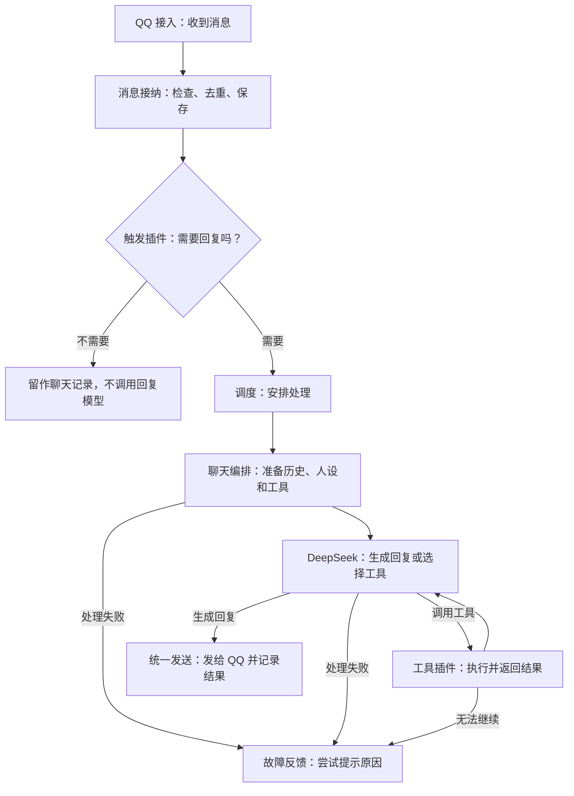

# 一条消息怎样变成回复

更新日期：2026-10-16。这里只解释处理过程和插件分工。目标见 [需求记录](需求记录.md)，当前完成情况见 [实现进度](实现进度.md)。

## 现在的处理过程

例如，群里有人说“今天小狼怎么没说话”，触发插件发现句中有“小狼”，就安排回复。聊天编排读取这个群最近的文字聊天，带上当前人设和可用工具交给模型，再把回复发回原群。

普通未触发的消息也可以保存，供后面的聊天理解使用；保存一条消息不等于一定回复它。

## 哪些插件一起完成这件事

| 插件 | 负责什么 |
| --- | --- |
| QQ 官方接入 | 连接 QQ、接收消息、执行发送请求。 |
| 消息接纳 | 检查来源，识别重复消息，保存收到的内容。 |
| 消息触发 | 判断是否回复；目前支持私聊、群 @ 和触发词。 |
| 任务调度 | 安排处理顺序和并发，管理等待、取消和超时。 |
| 会话存储 | 保存聊天、处理过程和发送结果，供后续回复读取。 |
| 默认聊天编排 | 串起上下文、人设、模型、工具和发送。 |
| DeepSeek 模型 | 负责模型请求和返回结果。 |
| 工具注册与执行 | 告诉模型有哪些工具，并执行它选择的工具。查询时间是目前的示例工具。 |
| 统一发送 | 配置普通／流式输出，逐段或更新同一消息，并记录 QQ 回执。 |
| 故障反馈 | 处理失败时给出明确提示，并避免重复提示。 |
| 日志处理、运行观察、配置管理 | 记录过程，为后台提供状态和配置读写。 |
| Cordis 插件加载器 | 加载插件，管理依赖和启停时的清理。 |

这些内置插件组合成当前文字主链路。终端日志展示和管理面板是外挂插件，同样显示在插件列表中。

内置表示当前文件在镜像里，外挂表示从挂载目录加载；以后可以调整归属。一个功能不必对应一个 npm 包，也不必单独运行一个容器。

## 后续能力怎样接进来

- 理解与记忆：提示词明确发言用户、群／私聊来源及当前日期、时间和时区；把图片理解结果、需要的历史和长期记忆交给上下文。图片是否预先压缩待讨论。
- 人设与学习：由人设插件提供统一表达要求，学习结果按确定的规则用于记忆或人设。
- 工具与行动：接入网页搜索和阅读等实用工具；MCP 和 Skills 由各自的接入插件对接工具层。
- 主动互动：触发插件判断是否插话；工具可以创建定时任务，由调度到时执行。
- 回复呈现：模型边生成，发送层按 QQ 能力逐步展示；实时分段回复和私聊原生流式是两种不同的展示方式。
- 表情包：收集和选用表情包，通过统一发送能力发出去。
- 管理界面：跟随已实现能力增加配置、查看和必要的管理操作。

这里说明接入方向，不表示这些功能已经实现。实际边界由助手随功能梳理，不固定插件数量，也不要求用户先设计工程接口。

## 改动后怎样更新

| 改哪里 | 怎样更新 |
| --- | --- |
| 主程序、服务接口、镜像依赖 | 本地修改后统一构建新镜像，由 NAS 直接下载、校验并部署。 |
| 使用现有能力的外挂插件或网页 | 更新 NAS 挂载文件；代码逻辑通常需要重启，静态页面刷新即可。 |
| 运行配置 | 不需要重新打镜像；目前在面板保存后应用并重启。 |

调度、发送、异常、日志、存储和后台等日常工程完善由助手直接推进，记录在 [实现进度](实现进度.md) 的工程部分。需要用户参与的是新能力的体验和使用规则，不是每个实现细节。

开发说明（需要改代码时再看）

- 启动和装配：`src/main.ts`、`src/app.ts`、`src/plugins.ts`。Cordis 管理服务依赖和插件生命周期；接入、触发和聊天编排可配置替换，其他服务随扩展需要完善替换入口。
- 主要代码：QQ 接入在 `src/adapters/qq-official.ts`，触发在 `src/trigger.ts`，编排在 `src/chat.ts`，存储和调度在 `src/store.ts`／`src/scheduler.ts`，模型与工具在 `src/model.ts`／`src/tools.ts`，发送与故障反馈在 `src/output.ts`／`src/fault-feedback.ts`。
- 插件通过服务接口协作；事件用于通知已经发生的事情。监听器、连接、定时器和任务都由插件负责释放，停用不删除用户数据。
- 当前按平台、环境、账号和会话隔离记录。执行时固定当前请求对应的历史范围，工具请求和结果一起保留或裁剪。
- 模型和工具受次数、时间与长度限制。工具操作结果不明时不能假定没有执行，也不能直接重复操作。
- 发送前保存发送意图，成功后保存回执；部分成功只确认已交付内容。结果未知不重发，失败草稿不进入已回复历史。
- 重启保留数据库，未完成工作记录为中断或未知。后续恢复按任务类型设计，避免重复发送和重复副作用。
- 故障提示包含中文原因、错误码和短轮次编号，最多尝试一次；已有正常发送意图时不追加。日志或观察插件失败不能拖垮聊天。
- 后台通过配置服务修改模型、QQ、触发和已声明的插件配置，写入 `data/settings.json`；不直接操作数据库或提供任意命令入口。配置启动成功后确认，QQ 启动失败回退。
- 机制来源与历史调研保留在 [初期调研](初期调研/)。当前直接复用 Cordis 官方 Loader；其他项目的插件不能假定直接互装。

### QQ 流式回复调研（2026-10-16）

- **已确认的平台能力：**腾讯官方 SDK 的 `stream_messages` 只支持私聊，效果是同一条消息持续更新；项目已安装的 `@tencent-connect/qqbot-nodejs@1.0.5` 已包含 `openStream()`，不用另换 SDK。SDK 要求传入累计全文，默认约 500 毫秒刷新，结束时发送完成标记。[官方 SDK 说明](https://github.com/tencent-connect/qqbot-nodejs/blob/main/USAGE.md#11-c2c-流式消息stream_messages)
- **连续分段方案：**模型以 SSE 返回增量内容，应用累积到完整句段后，调用普通 QQ 发消息接口，形成一段一段出现的效果。该方案是基于现有接口的实现建议，私聊和群聊都可评估；群聊没有上述原生流式接口。[DeepSeek 流式参数](https://api-docs.deepseek.com/api/create-chat-completion/)
- **群聊约束：**官方普通回复文档列出的群被动回复窗口为 5 分钟、每条入站消息最多回复 5 次；不同分段需要不同 `msg_seq`。因此不能逐 token 发送，分段时要保留剩余内容的发送名额。[QQ 发消息文档](https://github.com/tencent-connect/bot-docs/blob/main/docs/develop/api-v2/server-inter/message/send-receive/send.md)
- **当前实现：**“统一发送”插件配置 `mode: normal / streaming`。流式时模型使用 SSE；私聊约 500 毫秒更新累计全文，结束发送 DONE；群聊按句发送前四段，第五段合并余文。超过第五段字数容量会提示未发送余文，后台保留草稿并记为失败。思考内容、工具参数不发送；已开始输出后不重试模型请求，回执未知不重发。
- **真实验证：**NAS 私聊原生流式与群聊五段回复均收到 QQ 回执，用户确认客户端显示正常。
- **实现要点：**模型流、输出和 QQ 接入分别负责生成、分段／记录及平台发送。已发送内容要与历史一致；工具调用、思考内容和中途失败要单独处理。搜索结果含外链时也要遵守 QQ 的消息 URL 配置。
- **上下文核对：**`src/messages.ts` 已把用户标识与消息时间放入文字，群标识保存在内部消息中，但未明确呈现给模型；`src/chat.ts` 的系统提示词当前只有临时人设。后续补的是当前发言身份、会话来源和每次生成时的现实时间，不能只依赖旧消息的时间戳。OpenID 不能当作普通 QQ 号或自行推断群名。
- **另需核对：**上述 QQ 发消息文档顶部提示主动推送已停供，但正文仍保留旧额度说明。主动插话／定时推送实现前须核对最新开放接口及本机器人的实际能力，不能按旧额度直接承诺。

