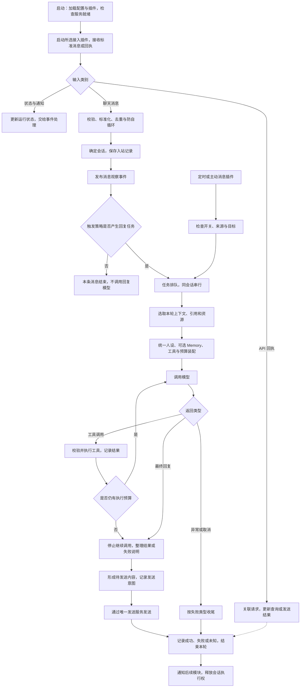

# 小狼主链路功能与执行流程

更新日期：2026-10-14。状态：功能讨论基线；用户随后授权开始实现，当前文字主链路进度见 [实现进度](实现进度.md)。本文未确认的默认策略仍可讨论调整。

本文是当前主链路讨论入口，列出完整功能、执行顺序、异常分支和插件边界。先讨论行为，再确定接口与实现。文中“已确认”来自用户；“建议”是供讨论的设计；“待讨论”尚未决定。执行流程和默认策略整体为助手建议，不因写入文档而视为用户已逐项确认。

## 1. 已确认方向与范围

- 使用 TypeScript＋Cordis 4，自行编写小狼的主链路与能力插件；不再采用 Python，也不把 AstrBot、Koishi、ChatLuna 或 YesImBot 作为必须运行的宿主。它们保留为实现参考。
- 参考 DeepSeek Harness 的插件化思想：包括聊天编排在内的能力通过明确接口组合，可以增减和替换。Cordis 负责插件运行机制，不自研第二套插件内核。
- 交付完整、可独立部署的小狼项目；个人定制、轻量克制、拟人化，计划开源。不建设第三方插件市场，不增加多平台需求。
- 用户已改为 QQ 官方机器人，取消 OneBot／NapCat 接入。接入实现必须是可替换插件；现有 AstrBot／NapCat 保持原样。
- 私聊普通消息默认回复；群聊由 @ 自身或配置称呼／触发词触发，词出现在句中也算触发，包括仅在谈论机器人。主动插话有独立开关。
- 使用一个统一人设；模型选用 DeepSeek V4.1 Flash。工具由 AI 自主选择和执行，无需每次询问用户。
- 九个已确认模块保留：触发与调度、人设与回复、规划与工具、Memory、图片、自学习、简单插件扩展、表情包、基础管理界面。
- 语音、注意力与行为学习、电脑操作暂不做。Mac 不运行机器人；运行测试在 NAS Docker 中进行。NAS 写操作必须获批。
- 本文最初形成时只调查和确定文档；用户随后授权开始实现。实现范围、验证和 NAS 边界见 [实现进度](实现进度.md)，NAS 部署仍须单独审批。

“自己编写”指自己掌握消息语义、聊天编排和模块接口；网络、数据库、模型客户端等成熟基础库仍可复用，具体依赖尚未选择。不是从零实现 WebSocket、数据库引擎或模型 SDK。

当前接入调整：首版 OneBot 运行代码已移除；以下 OneBot 调研条目和来源保留为历史参考，不再作为当前实现要求。群 @ 与称呼触发行为保留，但非 @ 消息能否到达需要验证官方应用权限。

## 2. 路线调查：可行，但要保留这些边界

结论：没有发现阻止这条路线的架构性问题。Cordis 4 适合承载小型插件化原型；是否稳定、轻量以及具体开发时间，需要后续原型和 NAS 联调验证，当前没有运行证据。

| 核对结果 | 对小狼的影响 | 建议处理 |
| --- | --- | --- |
| npm `cordis` latest 为 `4.0.0-rc.10`，核心为 ESM；对应 Loader 源码为 `1.0.0-rc.7`，仍带 RC 标记。[S1] | 可以作为候选，但不能当作接口已永久稳定，也不能只凭“快速原型”推断完整交付成本。 | 后续锁定框架、Loader 和 Node 版本，先验证最小装配；本文不安装或锁定依赖。 |
| 本次核对的 Koishi 4.18.11 核心依赖 Cordis 3。[S2] | OneBot、数据库、控制台、ChatLuna 等 Koishi 插件不能假定直接装进 Cordis 4。 | 优先参考协议和职责；要复用某个库，单独检查其是否依赖 Koishi 服务。 |
| Harness 使用改名发布的 `@deepseek-ai/cordis`，基于 Cordis 4 RC 源码并有本地修改。[S3] | 使用同一架构思想不等于共享同一运行时或可直接互装插件。 | 默认研究上游 Cordis 4；不直接引入 Harness 全套，也不默认维护其框架补丁。 |
| Cordis 提供依赖和资源清理机制，Harness 将模型、会话、工具和循环分别组织为插件。[S3][S4] | 能减少框架建设，但排队、发送结果、工具副作用和数据一致性仍由小狼定义。 | 下面将这些行为列为主链路职责；插件化与热更新分别验收。 |
| OneBot 11 WS 使用 `echo` 关联请求与响应，发送 API 返回消息 ID。[S5][S6] | `echo` 是关联标识，标准没有在这里提供发送去重承诺。断线可能造成“已执行但没收到回执”。 | 明确发送的成功、失败、结果未知；结果未知时不盲目重发。 |
| DeepSeek 官方将 V4.1 Flash 标识为 `deepseek-flash`，声明支持视觉与工具调用；思考模式的工具续接还有额外字段要求。[S7] | “OpenAI 兼容”不等于只传文本即可。协议字段若丢失，工具续接可能失败。 | 由模型适配器保留续接信息；文字、工具、图片分别联调。思考模式默认值另定。 |
| 现有项目的大量实现依赖自身的消息、配置、数据库和生命周期对象。 | 参考实现能降低探索成本，但不是换一种语言逐行翻译后就天然兼容。 | 保留原理和必要算法，按小狼的接口实现；实际复制文件或代码时记录来源及许可证。 |

成本判断：文字原型的范围可控；完整基础链路的主要工作在会话并发、工具循环、持久化与发送一致性。管理界面、长期 Memory、自学习和表情包属于后续模块，不能把它们的成本计入“文字原型已跑通”后就视为完成。

## 3. 主链路的边界与整体流程（建议）

主链路负责从输入事件到一轮处理结束的编排，调用接入、会话、模型、工具、存储和发送服务。普通观察、主动消息和后台学习有自己的路径，但共用需要的服务。

图中的异常节点按情况可以产生简短故障回复，或只记录失败；不把所有异常都转成一次新的模型调用。所有旁路观察也不等于自动运行学习或图像理解。

## 4. 按顺序列出的功能与执行细节（建议）

### A. 启动与接入

| 环节 | 必须明确的功能 | 产出与边界 |
| --- | --- | --- |
| 01 配置与插件装配 | 读取运行参数、模型配置、统一人设、插件启用项；检查字段和依赖；配置包含版本。密钥由运行环境提供，不写入普通日志或仓库。 | 必要服务缺失时明确标为未就绪；不接入后再静默丢消息。 |
| 02 基础服务就绪 | 初始化持久化、会话、模型、工具注册和发送服务；加载唯一默认聊天编排。 | 主链路停用可以停止回复；连接状态和日志仍可查看。具体依赖图待实现前确定。 |
| 03 接入插件连接 | 按配置启动唯一 Adapter；插件负责鉴权、连接和平台事件转换，主链路只接收标准消息。 | 当前实现 QQ 官方 WS，复用腾讯 SDK。实际可用事件依赖后台权限；不要求 NapCat 或 OneBot Token。 |
| 04 消息与回执分流 | 平台通知、心跳及 API 回执由接入插件处理；发送向主链路返回统一回执或明确的失败／未知状态。 | QQ SDK 类型、OpenID 和被动回复字段不进入核心协议。频道与额外平台事件暂不处理。 |

现有实现版本见实现进度。QQ 官方 WS 是当前工程候选，尚未连接真实应用或部署 NAS；官方旧事件文档与当前 SDK 存在描述差异，需要实际验收。

### B. 消息整理、保存与触发

| 环节 | 必须明确的功能 | 产出与边界 |
| --- | --- | --- |
| 05 标准化 | 保留机器人账号、群／私聊、发送者 ID、消息 ID、平台时间和接收时间；正文按文字、@、引用、图片等有序消息段整理；未知类型保留占位。 | 触发用的文本和模型输入分别派生，不用一条混合 CQ 码字符串承担所有语义。[S8] |
| 06 接入校验与去重 | 排除自身发送回流；判断消息来源是否启用；按平台／环境、账号、会话、消息标识识别重复。去重与入站记录的写入边界一致。 | 不凭正文相同去重；同一句连续发两次可能是两条真实消息。缺失稳定 ID 时记录限制，不承诺绝对去重。 |
| 07 会话定位与入站保存 | 私聊按机器人账号＋对方用户隔离；群聊按机器人账号＋群隔离，并保留每条消息的说话人。普通消息也能进入历史。 | 入站事实只保存一次；上下文用记录引用，不能在触发阶段又插入同一条消息。群临时私聊的路由保留来源，具体支持待定。 |
| 08 观察事件 | 将已接纳消息发布给历史观察、表情包收集、学习等订阅者；订阅者独立处理自己的工作。 | 一个观察插件失败不阻断基础回复；观察不自动获得发言权，昂贵操作不阻塞入站链路。 |
| 09 触发判断 | 按私聊、群 @、任意位置称呼／触发词判断；记录本次触发理由；主动插话走独立开关和策略。 | 一条消息同时满足多个条件只产生一个默认回复任务；未触发消息不进入默认回复模型。 |

**已确认的触发行为：**

| 输入 | 结果 |
| --- | --- |
| 私聊普通消息 | 默认产生回复任务。 |
| 群聊 @ 小狼 | 产生回复任务。 |
| 群聊“今天小狼怎么没说话”且“小狼”为配置词 | 产生回复任务，不要求在开头，也不要求是对机器人提问。 |
| 群聊没有 @ 或配置词，主动插话关闭 | 不产生主动回复；仍可供观察。 |
| 主动插话开启 | 允许独立策略决定；策略本身尚未确认，不默认等同于随机概率。 |

**新增细节建议，待讨论：**触发词先按本条消息直接文本匹配；引用原文、合并转发内部文字、图片 OCR 不自动算触发文本。@ 全体不等于 @ 自身。大小写、别名和具体词表在触发模块一起确定。

### C. 调度与上下文

| 环节 | 必须明确的功能 | 产出与边界 |
| --- | --- | --- |
| 10 任务与排队 | 把触发转成带来源、目标、触发消息和唯一标识的任务；同会话一次只运行一个；不同会话允许有上限地并行。 | 建议首版 FIFO，不自动合并、插队或取消前一条；队列有容量和过期策略，具体值待定。新消息不悄悄改写正在执行的请求。 |
| 11 选取上下文 | 等到任务执行时读取本会话历史；最近对话包含说话人、时间和消息关联；解析引用原文，按需获取图片等资源。 | 本轮触发消息必须保留；建议固定接纳输入的边界，不把后来普通消息自动算作当前请求。队列中较早回复可作为后续任务上下文。 |
| 12 人设、Memory 与预算装配 | 使用统一人设；添加本轮任务、相关上下文和可用工具；Memory 插件可按已授权范围返回资料；控制输入长度并预留输出和工具结果空间。 | 统一人设不等于共享所有聊天历史。没有 Memory 插件时基础聊天仍工作；旧消息先裁剪，摘要算法后续另定。 |

补充约束：

- 群历史按群保存；上下文中保留谁说的话，不把所有人混成同一个人。跨群 Memory 策略未确认前，不默认跨群检索。
- 当前直接消息、引用文字、检索资料与工具结果保持来源标记；引用或网页里的文字不提升为系统人设，也不改变工具的实际权限范围。
- 持久化历史、最近上下文和长期 Memory 是三个职责；首版历史不是长期 Memory 的完成版。
- 图片标识／URL／平台资源路径不等于图片字节。资源取得需由媒体服务处理；容器间不假定路径共享。图片失败时保留“资源不可用”，不编造图像理解。[S9]
- 纯语音、视频、文件等未支持内容怎么回复属于输入处理待讨论；不默默启用转写或电脑操作。
- 输入截断不能拆断一组 assistant 工具调用和对应结果，也不能为了省上下文丢失模型续接所需字段。

### D. 模型与自动工具循环

| 环节 | 必须明确的功能 | 产出与边界 |
| --- | --- | --- |
| 13 模型请求 | 适配器接收统一消息和工具定义，调用 `deepseek-flash`；处理超时、限流、取消、输出截断和服务错误；返回文本、工具请求、用量与必要续接字段。 | 建议首版完整收取一轮结果后再发送 QQ；API 是否内部使用流式不等于 QQ 逐 token 发消息。 |
| 14 工具选择与执行 | 模型决定是否调用已注册工具；检查工具存在、参数格式、调用范围；分配调用 ID；记录执行开始与结果；把结果交还模型。 | 工具列表来自本轮可用能力，不是模型任意指定脚本即可执行。用户已确认不逐次审批，运行范围在配置和工具接口中确定。 |
| 15 继续或结束循环 | 有工具调用时保留 assistant 工具请求，为每个调用记录对应结果，再请求模型；没有工具调用且有可用最终文本则结束。 | 有轮数、耗时和输出预算，重复无进展时停止。工具出错作为明确结果返回，不能伪装成功或无限重试。 |

循环需要确定的细节：

1. 不要求独立“规划模型”或额外规划调用。首版由当前模型完成回复与工具选择，省去不必要的模型请求。
2. 建议工具默认按返回顺序执行；只有明确可并行、互不影响的工具才并行。工具应区分只读查询与有副作用操作。
3. 模型返回工具调用时，伴随的说明文本不默认先发送 QQ；最终只通过发送环节输出，防止“查一下”与最终回复重复散落。
4. 参数无效、工具停用、执行失败、取消和结果未知分别表示。每个已接受调用有对应结算记录，不能留下无法续接的历史。
5. 超时或进程退出不意味着外部工具没有执行。已发出的副作用操作不因模型重试、重启或插件替换而自动重放。
6. 若工具已成功而后续模型失败，保留结果，不能整轮从头执行工具。若有足够结果可做确定性说明，否则简短报错收尾。
7. DeepSeek 思考模式携带工具时需要按官方要求回传 `reasoning_content` 等续接信息；这类字段由模型服务维护，不当作 QQ 最终回复，不默认输出到普通日志。[S7]
8. 达到预算后停止接纳新工具，保留已完成事实，给出可生成的结果或简短限制说明。最多是否允许一次无工具总结请求及参数值待讨论。

MCP、Skills、脚本都是未来接入工具注册服务的方式；工具循环成立不代表这些协议和运行环境已经实现。首轮工具验收建议只接一个确定性的简单工具。

### E. 回复、发送与结算

| 环节 | 必须明确的功能 | 产出与边界 |
| --- | --- | --- |
| 16 形成输出与发送意图 | 将最终结果变成有序消息段；处理空回复、超长内容、文字与可选图片；记录本次回复对应的任务和目的会话。 | 建议首版单条文字优先；超过平台限制才分段。模型文字以文本段发送，不能直接作为任意 CQ 指令执行。 |
| 17 统一发送 | 所有回复通过一个发送服务，确认目标、任务状态、插件是否仍可发送；关联 API 请求、等待回执；分段发送保持顺序。 | 群消息不能因发送者 ID 与私聊路由混淆而发错目标；后续主动消息和表情包也共用此出口。 |
| 18 保存结果并结束 | 分开保存“模型生成了什么”和“平台发送结果”；成功记录平台消息 ID；失败、未知和部分发送保留状态；释放会话执行权并通知后续模块。 | 模型回答已生成不等于已发出；发送成功也不等于对方已读。失败草稿不作为已交付聊天内容进入后续上下文。 |

发送建议：

- 发请求前先保存发送意图；成功后记录回执，便于重启时识别未完成工作。
- 明确未发出与明确被拒绝，可以按类型有限处理；请求已发出但回执丢失时标记未知，不能把 `echo` 当作服务端幂等键。[S5][S6]
- 多段回复记录每段状态，不把“第一段已发、第二段未知”改写为整条失败后全部重发。
- 不承诺跨 QQ 平台和本地数据库的绝对一次发送。优先避免重复操作，未知结果可在管理入口核查。
- QQ 自身消息回流与本地成功记录需要关联，不能再触发一轮或在上下文重复保存。
- 基础会话与发送状态的持久化失败属于主链路故障；Memory、自学习或收集等可选模块失败则独立记录，不把已发送回复重新发一次。

## 5. 轮次状态、故障和重启（建议）

以下是行为状态，不是数据库表或接口定义。一个任务最终必须有完成、失败、取消、过期或需要核查的结果，不永久停在“执行中”。

正常轮次：已排队 → 执行中 → 可选工具等待 → 待发送 → 发送中 → 已完成。

| 情况 | 建议行为 |
| --- | --- |
| 消息未触发 | 入站记录完成即可；不创建默认模型任务。 |
| 同会话新消息到达 | 保存消息；需要回复则排队。首版不动态注入当前模型调用，也不自动打断当前工具。 |
| 模型连接失败／限流 | 在本轮预算内有限退避；参数、凭据等确定性错误不重复请求；工具和发送动作不跟着重放。 |
| 工具参数错误或普通执行失败 | 给模型明确失败结果，允许预算内调整；不把异常堆栈直接发 QQ。 |
| 工具已发出但执行结果未知 | 记录未知；不自动执行同一副作用操作。任务如何向用户说明取决于已有可确认事实。 |
| 回复发送未知 | 保留生成结果和发送意图，待核查；不因超时再发同一段或另一条可能重复的故障提示。 |
| 取消／插件停用 | 停止接纳新任务和新工具；协作取消可取消请求；已发生的外部操作保留记录。停用不等于回滚副作用。 |
| 运行中更新配置 | 建议每轮保留一份有效配置版本；新轮次使用新配置。紧急停用在发送和执行前重新检查，不能靠旧快照绕过。 |
| 进程重启 | 加载配置与已有历史；识别未完成任务和工具／发送状态，标注中断或未知。建议首版不自动重放未完成副作用或发送。 |
| 接入插件断线恢复 | 恢复接入；不假定断线期间消息已经补齐。历史补查不是首版自动行为。[S9] |
| 队列拥堵或消息过期 | 有容量、等待时长和过期结果；是否发送一次忙碌提示及旧任务处理方式待讨论。 |
| 后台收集或学习失败 | 独立报告插件错误，不破坏已完成聊天，也不自动开启回复。 |

需要记录：任务来源、会话、触发消息、触发理由、有效配置版本、各阶段耗时、模型调用用量、工具状态和发送状态。日志按必要范围保留，避免默认复制全部聊天正文、媒体字节或凭据。具体保留周期和查看权限待管理模块讨论。

## 6. 如何落实“主链路本身也是插件”（建议）

按可替换职责划分，不要求流程表中的 18 步各发布一个包。所有插件首版可以在同一个 Node 进程里运行，插件化不增加容器数量。

| 能力／插件 | 拥有的职责 | 不应承担的职责 |
| --- | --- | --- |
| 启动装配 | 将配置交给 Cordis，挂载插件，汇总就绪与退出状态。 | 写死聊天步骤或业务人设。 |
| 平台接入与发送插件 | 连接、协议转换、请求关联、状态和输出。 | 决定要不要回复、拼人设、选择工具。 |
| 存储提供者 | 持久化与必要原子写入，提供明确读写边界。 | 决定所有消息都要变成人物记忆。 |
| 会话与任务调度 | 会话标识、历史查询、排队和轮次状态。 | 把某个具体聊天循环写进通用队列。 |
| 触发策略 | 私聊、@、称呼匹配和主动开关，产生带理由的任务。 | 自己另起一条模型调用和发送流程。 |
| 上下文与人设提供者 | 选择本轮输入、统一人设、预算与可选扩展材料。 | 任意修改其他插件的数据库或内部对象。 |
| 模型提供者 | DeepSeek 协议适配、取消、续接和错误分类。 | 控制群聊路由或直接操作 QQ。 |
| 工具注册与执行 | 工具描述、参数校验、执行范围、调用结果和生命周期。 | 自行无限启动后续聊天轮次。 |
| 默认聊天编排 | 调用上述能力，组织模型／工具循环、输出和收尾。 | 内置不可替换的连接、数据库和全部未来模块。 |
| 可选功能 | Memory、媒体理解、学习、表情包、定时与主动消息、管理界面。 | 绕过排队、触发策略或发送出口产生第二套默认回复。 |

服务调用负责需要返回值的工作；通知事件用于观察已发生事实。会改变结果的扩展必须声明顺序和失败策略，不用无序监听器随意改共享对象。

首版需要做到：

1. 主链路停用后停止接纳回复任务，消息接入、记录和运行观察仍可保留；换入另一编排后同一条消息只回复一次。
2. 必要提供者缺失或失败时，依赖方明确显示未就绪；可选能力停用时，基础聊天继续运行。
3. 监听器、定时任务、网络连接与未完成请求归属插件生命周期，停用后有清理结果。[S4]
4. 插件停用与用户数据删除分开；不通过卸载删除历史或 Memory。
5. 首版允许通过重启应用生效插件组合变更。无中断热更新、事务式回滚和在线安装不是已确认需求，不为“万物皆插件”预先实现整套市场。
6. 插件版本与数据格式需要可识别；替换实现时检查历史是否可读取，不能假定接口相同就共享同一数据库结构。

## 7. 九个模块如何接入主链路

此表列接入职责，不提前决定每个模块的内部实现。

| 已确认模块 | 接入位置 | 基础闭环与后续边界 |
| --- | --- | --- |
| 触发与调度 | 09 触发、10 排队，以及定时任务入口。 | 私聊／群触发先实现；主动与定时另定策略，所有回复任务进入统一调度。 |
| 人设与回复 | 12 装配、13 模型、16 输出。 | 首版一个统一人设；风格材料不能偷偷改变人设定义。 |
| 规划与工具 | 14—15 工具循环。 | 基础循环和简单工具先验；MCP、Skills、脚本逐项接入。 |
| Memory | 12 按范围召回，工具入口支持记忆纠错删除，18 后处理可写入。 | 长期策略与跨群范围待讨论；无此插件也能普通聊天。 |
| 图片处理 | 05 识别、11 取资源、12—13 多模态输入。 | 直接交支持视觉的模型；媒体理解可选启用，资源失败有可见状态。 |
| 自学习 | 08 观察，独立定时后台任务；产出供 Memory／人设装配使用。 | 不在每条消息上同步学习；自动生效尚未确认。 |
| 简单插件扩展 | 所有提供者、观察和有限扩展点。 | 第一版就有依赖与清理约定，不预建第三方市场。 |
| 表情包 | 08 收集观察、工具／输出阶段选用、17 统一发送。 | 收集、选用、发送可独立关闭；频率和图库共享待讨论。 |
| 基础管理界面 | 读取配置、插件和任务状态，通过已定义服务修改。 | 配置、日志、插件状态为起点；页面清单后定，不直接操作业务内部对象。 |

## 8. 原型与完整基础链路的验收分层（建议）

以下为设计阶段提出的实施顺序。用户随后授权本地实现和必要依赖，NAS 部署仍需单独审批；实际完成项以 [实现进度](实现进度.md) 为准。

| 阶段 | 应验证的结果 | 仍不能据此宣称 |
| --- | --- | --- |
| 文字原型 | Cordis 装配；QQ 官方接入；标准消息；已确认触发规则；统一人设；一次文字生成与发送；历史保存；主链路有独立插件边界。 | 已有成熟稳定性，或九个模块完成。 |
| 完整基础链路 | 同会话排队和隔离、消息去重、自循环防护、上下文预算、断线与重启收尾、发送未知状态、一个自动工具循环、插件依赖与清理。 | 已实现长期 Memory、自学习、表情包策略或完整管理页面。 |
| 能力插件逐块加入 | 图片、Memory、表情包、学习、主动／定时和管理按各自讨论结果接入。 | 这些能力只需翻译现成代码、没有集成成本。 |

基本验收场景：

- 私聊默认回复；群 @ 回复；“今天小狼怎么没说话”触发；无触发普通消息只观察。
- 同条消息同时 @ 与包含称呼只产生一个默认任务；重复事件不重复生成；机器人自身消息不引起循环。
- 两个群和私聊的最近历史隔离，群内保留说话人，统一人设不造成跨群资料泄露。
- 同会话连续触发按选择的排队规则处理；另一会话可以继续工作；每条触发消息只进入本轮输入一次。
- 简单工具成功后模型使用真实结果回复；参数错、超时、超预算和工具停用可收尾；后续模型失败不重放已完成工具。
- 模型返回空内容、输出截断、限流和取消有结束状态；失败不会永久占用会话。
- 发送成功记录消息 ID；回执丢失标记未知；分段部分成功不整条重发。
- 重启保留历史与配置，标识中断任务；平台重连不宣称自动补齐历史。
- 主链路停用、替换和恢复后无残留回复；可选观察插件失败不阻塞基础聊天。
- 图片插件关闭或资源获取失败时不编造识图结果；启用后验证目标模型实际请求格式。

这些是完整行为验收清单；后续已实现其中的模拟验证，真实 QQ／NAS 验收尚未进行，见 [实现进度](实现进度.md)。

## 9. 后续按大模块讨论的顺序

已确认事项不再重复提问。每次集中讨论一块，把行为例子、默认策略和异常情况一起定下来。

1. **触发、观察与调度**：未触发消息的保存范围，排队／合并／打断，主动开关范围；任意位置称呼规则已确认。
2. **会话、上下文与统一人设**：一轮输入边界、最近历史、引用和图片、长度预算、重启恢复；Memory 共享单独保留决策。
3. **模型与工具执行**：思考与输出方式、首批工具、执行边界、循环预算、失败与取消；不重复询问是否每次审批。
4. **回复发送与记录**：引用／@、长回复拆分、失败提示、发送未知和部分成功如何呈现。
5. **插件生命周期与基础管理**：哪些能力可独立停用、变更何时生效、状态和日志怎么查看。

需要数值的参数先在对应模块确定，不在这一轮逐个追问阈值；原型可调参数不能在文档里冒充用户确认。

## 10. 调研来源、基线与本轮操作

2026-10-14 读取官方文档、npm 元数据及参考源码。npm 查询候选：`cordis@4.0.0-rc.10`，gitHead `f8ea3cd50f1a5724e8e715995bcde131c9c12b2c`；`@koishijs/core@4.18.11`，gitHead `506be1ef16d9c0c0f04069fb4b2f0a403cc19833`。这不是小狼依赖锁定。

- [S1 Cordis npm 元数据](https://registry.npmjs.org/cordis/latest)、[核心源码 manifest](https://github.com/cordiverse/cordis/blob/main/packages/core/package.json)、[Loader manifest](https://github.com/cordiverse/cordis/blob/main/packages/loader/package.json)。
- [S2 Koishi 核心依赖基线](https://github.com/koishijs/koishi/blob/506be1ef16d9c0c0f04069fb4b2f0a403cc19833/packages/core/package.json)。
- [S3 Harness 架构](https://deepseek-harness.github.io/deepseek-harness/en/reference/)、[vendor 版本与本地修改](https://github.com/deepseek-ai/deepseek-harness/blob/master/vendor/README.md)。
- [S4 Cordis 生命周期实现](https://github.com/cordiverse/cordis/blob/main/packages/core/src/fiber.ts)、[Koishi 可逆插件设计（机制参考，非 Cordis 4 API 契约）](https://koishi.chat/zh-CN/cookbook/design/disposable)。
- [S5 OneBot 11 正向 WebSocket](https://github.com/botuniverse/onebot-11/blob/master/communication/ws.md)。
- [S6 OneBot 11 公开 API](https://github.com/botuniverse/onebot-11/blob/master/api/public.md)。
- [S7 DeepSeek 模型能力](https://api-docs.deepseek.com/quick_start/pricing/)、[工具调用](https://api-docs.deepseek.com/guides/tool_calls/)、[思考模式与工具续接](https://api-docs.deepseek.com/guides/thinking_mode/)。
- [S8 OneBot 数组消息格式](https://github.com/botuniverse/onebot-11/blob/master/message/array.md)。
- [S9 NapCat 信息接口概览及固定源码来源](NapCat信息接口概览.md)。
- 参考实现：[AstrBot v4.28.2 工具循环](https://github.com/AstrBotDevs/AstrBot/blob/v4.28.2/astrbot/core/agent/runners/tool_loop_agent_runner.py)、[OneBot 适配器参考基线](https://github.com/koishijs/koishi-plugin-adapter-onebot/blob/058d8488aeef069751b0a84e066d48d1e2298225/src/ws.ts)。只借鉴职责、请求关联和异常处理，不视为可脱离原宿主直接使用。

本节记录设计调研阶段：当时只做只读调查并修改本地 Markdown，未编写代码、安装依赖、运行机器人或操作 NAS。随后用户授权提交、推送并开始本地实现，具体状态见 [实现进度](实现进度.md)。

当前 QQ 接入来源：[腾讯官方 Node.js SDK](https://github.com/tencent-connect/qqbot-nodejs)、[事件订阅文档](https://github.com/tencent-connect/bot-docs/blob/main/docs/develop/api-v2/dev-prepare/interface-framework/event-emit.md)。
